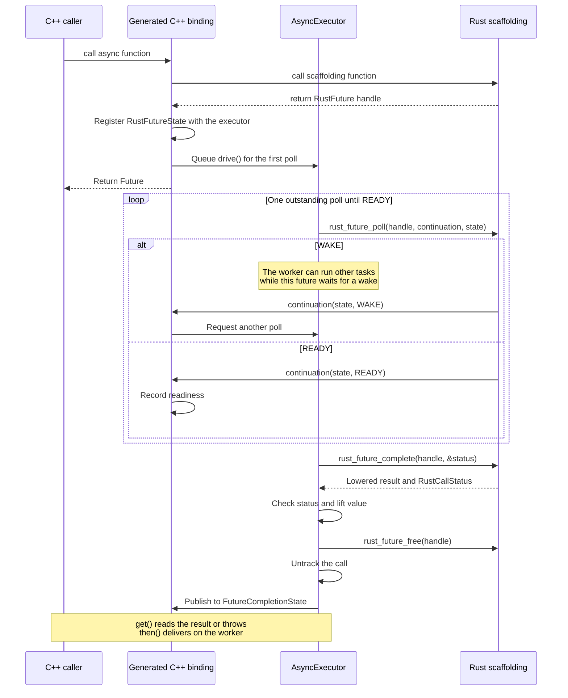
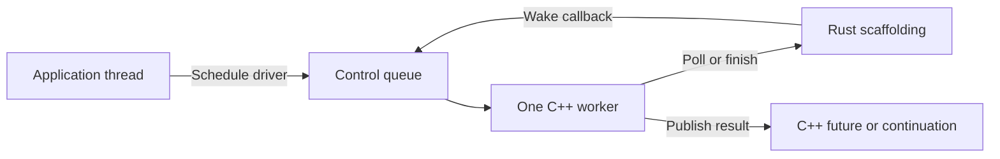
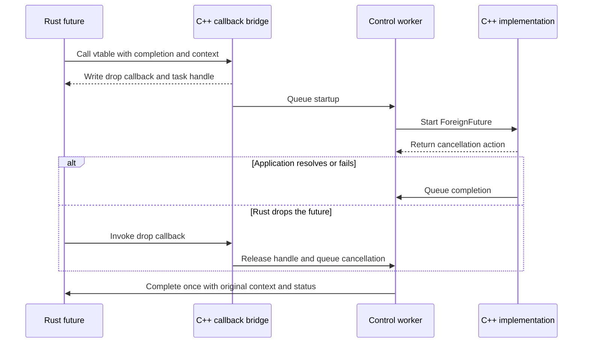

# Async Runtime

## Overview

UniFFI uses the foreign bindings' runtime to schedule Rust future polls and completions. C++ has
no default async runtime for this work. The generated bindings provide a shared
[`AsyncExecutor`](../bindgen/src/bindings/cpp/templates/async.hpp) for async Rust exports and
C++ callback methods that Rust awaits.

- **One worker thread.** Generated components in each linked executable or shared library share a
  worker and a FIFO queue. [Executor][executor]
- **UniFFI Rust future calls.** The wrapper obtains the future handle on the caller's thread.
  The worker calls `rust_future_poll` and repolls on `WAKE`. On `READY` it calls
  `rust_future_complete` to collect the value or error, then `rust_future_free` to release the
  handle. It requests cancellation with `rust_future_cancel`. [UniFFI handle rules][rust-handle-rules]
- **Pending calls and continuations.** The worker can run other tasks while a future waits for a
  wake. C++ continuations run on the worker, so keep them short and do blocking waits on
  application threads. [Continuation delivery][completion] · [Wait guard][wait-guard]
- **Async C++ callbacks.** When Rust awaits a C++ `ForeignFuture<T>`, the worker starts the
  callback and delivers its result or handles cancellation. [Callback bridge][callback-results]
- **Shutdown and restart.** Call `shutdown_async_executor()` from an application thread to stop
  admission, cancel outstanding work, drain the queue, and join the worker. Call
  `start_async_executor()` to reopen admission. [Shutdown][shutdown] · [Restart][restart]

The sequence adapts the [UniFFI Async Overview][upstream-sequence] to the C++ executor.

## Execution model

The `async_executor()` singleton creates a joinable worker on first use. The worker takes short
tasks from a FIFO queue and sleeps on a condition variable when the queue is empty. Pending Rust
futures retain their state and wake callback. Each driver runs at most 64 actions per turn before
yielding to the queue. [Executor][executor] · [Driver][drive]

A move-only `Future<T>` supports `wait()`, `wait_for()`, `get()`, `cancel()`, and a consuming
`then()`. `get()` returns the lifted value or rethrows the stored exception. `then()` transfers
cancellation ownership to its return value, a `FutureContinuation`, and delivers the result on
the worker. Hold that token until delivery or cancel it to request cancellation. Only application
threads may block on an incomplete call. The worker can inspect readiness or consume a ready result.
[Future API][future] · [Completion state][completion] · [Worker wait guard][wait-guard]

Access each `Future<T>` or `FutureContinuation` from one thread at a time. Before calling `get()`
or `then()`, use `cancel_handle()` to obtain a copyable `FutureCancelHandle` for a different thread.
The handle can request cancellation while `get()` waits or after `then()` takes ownership. Its
weak reference keeps cancellation harmless after completion. [Cancel handle][cancel-handle] ·
[Rust cancellation state][state-start]

## C++ calls an async Rust export

The generator uses the same driver for free functions, primary and secondary constructors, and
methods on objects, records, and enums. The wrapper checks the Rust contract version and checksums,
lowers the arguments, and calls the start symbol to obtain a `uint64_t` Rust future handle. The
generator selects poll, cancel, complete, and free symbols from UniFFI metadata for the lowered
result type. It also selects the value and error conversions, including the `void` case. An admitted
object method passes a cloned receiver handle. A record or enum method lowers its receiver by value
inside the start call. Rust owns the lifted receiver across polls and writes `RustCallStatus` through
an out pointer on completion. [Function template][function] · [Object template][object] ·
[Value methods][value-methods] · [Flat enum methods][flat-enum-methods] ·
[Async call macros][macros] · [Initialization][init] · [Rust scaffolding][tokio]

- **Create a handle and poll with a callback and opaque data.** `rust_call_async` gives the acquired
  handle to a scope guard. `start()` registers shared ownership of `RustFutureState` with the
  executor and schedules the first poll. The poll passes the state's address as callback data.
  The callback takes a strong reference to the state on entry.
  [Handle guard][handle-guard] · [Start and callback lifetime][state-start] · [Poll][poll]
- **Poll again on `WAKE` and complete on `READY`.** The callback clears `poll_outstanding_` and
  records `poll_requested_` for `WAKE` (`1`) or `ready_` for `READY` (`0`) under the state mutex.
  `next_action()` sets `poll_outstanding_` before invoking Rust and admits another poll only after
  that callback. Rust guarantees one callback per poll, which can arrive from another thread.
  [C++ state transitions][continuation] · [Rust poll guarantee][rust-poll]
- **Complete once and stop polling.** `next_action()` gives `READY` priority and sets `terminal_`
  before returning `CompleteFuture`. That flag closes the driver, callback, and cancellation paths.
  The worker completes once, checks `RustCallStatus`, and lifts the value on success.
  [Action selection][next-action] · [Result conversion][finish] · [Status handling][status]
- **Free the handle as the last FFI operation.** The driver frees the handle before removing the
  registry entry and publishing the result. Status, lifting, and result-transfer failures are
  stored as exceptions for the caller. The scope guard owns the handle until registration
  succeeds. It frees the handle if registration fails, including when admission closes during
  handle creation. The wrapper arms `Future<T>` cancellation after successful registration.
  [Completion and free][finish] · [Guard and handoff][call-async] · [Admission race][state-start]
- **Serialize optional cancellation with the rest of the lifecycle.** `cancel()` and token
  destruction request work on the driver. It sends at most one `rust_future_cancel`. After the
  driver sets `terminal_`, only completion and free can touch the handle.
  [Action selection][next-action] · [Cancellation FFI call][cancel] ·
  [Rust handle rules][rust-handle-rules]

Wake-ups also work when Rust invokes the callback inline during `poll`. `scheduled_` and `driving_`
coalesce driver requests. The driver rechecks the flags under the mutex before parking, covering a
callback that arrives as the driver is about to yield. FFI calls run with the state mutex released,
so inline callbacks can acquire it and return. [Driver scheduling and parking][drive]

Cancellation with a poll outstanding produces `READY` from the Rust scheduler. If cancellation
arrives before a callback is installed, the worker polls the cancelled handle to get `READY`.
`complete` consumes any result already produced by Rust. If Rust has no result, it reports
`Cancelled` and drops the pending future. The C++ wrapper maps that status to `AsyncCancelledError`
and runs the same cleanup path. This preserves results that win the cancellation race.
[C++ cancel path][cancel] · [Rust scheduler][rust-scheduler] · [Rust completion][rust-complete]

## Rust awaits an async C++ callback

A generated async callback method returns a move-only `ForeignFuture<T>` on the C++ side. Its start
function accepts success and failure callbacks and returns an optional cancellation action. In the
FFI vtable, the method returns `void` and accepts a completion function, its original `uint64_t`
context, and an output slot for the drop callback. The trampoline fills the drop slot, lifts the
arguments, and queues startup. Application code can arrange blocking work on an application
worker and signal completion from that worker. [C++ callback surface][callback-api] ·
[Vtable trampoline][callback-entry] · [Upstream async API client][api-client]

The `finished_` gate in `ForeignFutureTaskState` is shared by success, error, and cancellation.
The first terminal action takes that gate. Success lowers a value into the metadata-defined result
structure. Failure sends a declared UniFFI error or an unexpected exception message, including
exceptions from moving a value into the queue or lowering it. A `void` completion carries just the
status. The completion function consumes Rust's one-shot sender using the original context. These
paths run on the control worker for an active executor, even when an application worker supplies
the result. [Completion lowering and queueing][callback-results] ·
[Terminal gate][foreign-state] · [Rust receiver and completion callback][rust-foreign]

The drop slot owns a separate handle to the C++ task state. The state retains the callback object
through the registered cancel action, and moves that action out of its mutex before running or
releasing it. If cancellation takes the terminal gate, the drop path requests application
cancellation and sends a cancelled completion to release Rust's sender. If completion took the
gate, a later drop just releases the C++ handle.
[Startup and retained callback object][callback-results] ·
[Drop callback and cancellation][foreign-drop] · [UniFFI foreign handle contract][foreign-rules]

## Shutdown

Stop producers before calling `shutdown_async_executor()` from an application thread. The executor
closes admission, requests cancellation for registered calls, drains the queue and in-flight work,
and joins the worker. Continuation delivery retains its own registration until its callback is
released. Keep control callbacks short so other calls and shutdown can make progress.
[Drain and join][shutdown] · [Continuation registration][registration]

Once admission closes, the driver sends cancellation before polling a pending Rust future.
This covers a C++ callback that reports shutdown before the executor reaches the outer Rust
call's registered cancellation. The driver still completes a future that has already signaled
`READY`. [Action selection][next-action]

New C++ calls to async Rust exports receive `AsyncExecutorError` until an application thread calls
`start_async_executor()`. Start waits for any concurrent shutdown to finish joining the worker,
then opens admission. Calling start on a running executor is harmless. Operation IDs continue
increasing across restarts. The callback trampoline checks admission and its own state before it
starts work, so rejected or retired callbacks stay inactive after restart. [Restart][restart] ·
[Callback bridge][callback-results]

The singleton has process lifetime. Returning from `main` or calling `std::exit` leaves pending
work and its Rust handles to process teardown. Python, Kotlin, and TypeScript UniFFI bindings
likewise rely on their host runtimes for process exit. Use explicit shutdown before unloading
the generated bindings or the Rust library. [Singleton lifetime][executor]

[upstream-sequence]: https://mozilla.github.io/uniffi-rs/latest/internals/async-overview.html#rust-async-functions
[rust-handle-rules]: https://mozilla.github.io/uniffi-rs/latest/internals/async-ffi.html#managing-the-rustfuture-handle
[foreign-rules]: https://mozilla.github.io/uniffi-rs/latest/internals/async-ffi.html#managing-the-foreignfuture-handle
[api-client]: https://github.com/mozilla/uniffi-rs/tree/05b45b110f652d58d94c653992aeb3adc3a094f4/examples/async-api-client
[tokio]: https://github.com/mozilla/uniffi-rs/blob/05b45b110f652d58d94c653992aeb3adc3a094f4/uniffi_macros/src/export/scaffolding.rs#L271-L299
[rust-poll]: https://github.com/mozilla/uniffi-rs/blob/05b45b110f652d58d94c653992aeb3adc3a094f4/uniffi_core/src/ffi/rustfuture/mod.rs#L119-L149
[rust-scheduler]: https://github.com/mozilla/uniffi-rs/blob/05b45b110f652d58d94c653992aeb3adc3a094f4/uniffi_core/src/ffi/rustfuture/scheduler.rs#L80-L84
[rust-complete]: https://github.com/mozilla/uniffi-rs/blob/05b45b110f652d58d94c653992aeb3adc3a094f4/uniffi_core/src/ffi/rustfuture/future.rs#L162-L179
[rust-foreign]: https://github.com/mozilla/uniffi-rs/blob/05b45b110f652d58d94c653992aeb3adc3a094f4/uniffi_core/src/ffi/foreignfuture.rs#L67-L99
[executor]: ../bindgen/src/bindings/cpp/templates/async.hpp#L15-L150
[drive]: ../bindgen/src/bindings/cpp/templates/async.cpp#L210-L296
[future]: ../bindgen/src/bindings/cpp/templates/async.hpp#L429-L547
[cancel-handle]: ../bindgen/src/bindings/cpp/templates/async.hpp#L410-L427
[completion]: ../bindgen/src/bindings/cpp/templates/async.hpp#L301-L389
[wait-guard]: ../bindgen/src/bindings/cpp/templates/async.hpp#L161-L167
[function]: ../bindgen/src/bindings/cpp/templates/fn_def.cpp#L1-L20
[object]: ../bindgen/src/bindings/cpp/templates/obj.cpp#L32-L78
[value-methods]: ../bindgen/src/bindings/cpp/templates/value_methods.cpp#L1-L14
[flat-enum-methods]: ../bindgen/src/bindings/cpp/templates/flat_enum_methods.cpp#L1-L14
[macros]: ../bindgen/src/bindings/cpp/templates/macros.cpp#L69-L164
[init]: ../bindgen/src/bindings/cpp/templates/wrapper.cpp#L13-L37
[handle-guard]: ../bindgen/src/bindings/cpp/templates/async.cpp#L115-L134
[state-start]: ../bindgen/src/bindings/cpp/templates/async.cpp#L149-L188
[poll]: ../bindgen/src/bindings/cpp/templates/async.cpp#L298-L302
[continuation]: ../bindgen/src/bindings/cpp/templates/async.cpp#L184-L208
[next-action]: ../bindgen/src/bindings/cpp/templates/async.cpp#L227-L249
[finish]: ../bindgen/src/bindings/cpp/templates/async.cpp#L314-L344
[status]: ../bindgen/src/bindings/cpp/templates/wrapper.cpp#L40-L64
[call-async]: ../bindgen/src/bindings/cpp/templates/async.cpp#L367-L402
[cancel]: ../bindgen/src/bindings/cpp/templates/async.cpp#L304-L312
[callback-api]: ../bindgen/src/bindings/cpp/templates/callback.hpp#L6-L35
[callback-entry]: ../bindgen/src/bindings/cpp/templates/callback_iface_tmpl.cpp#L7-L22
[callback-results]: ../bindgen/src/bindings/cpp/templates/callback_iface_tmpl.cpp#L24-L140
[foreign-state]: ../bindgen/src/bindings/cpp/templates/async.cpp#L9-L93
[foreign-drop]: ../bindgen/src/bindings/cpp/templates/async.cpp#L70-L113
[shutdown]: ../bindgen/src/bindings/cpp/templates/async.hpp#L73-L99
[restart]: ../bindgen/src/bindings/cpp/templates/async.hpp#L59-L71
[registration]: ../bindgen/src/bindings/cpp/templates/async.hpp#L291-L299
